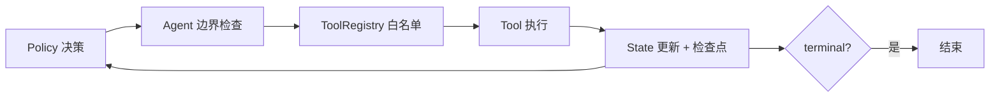

# agent-workflow-mini

一个把**工程边界放在智能前面**的最小 Agent 状态机。零第三方依赖，clone 下来就能跑通「查询订单 → 判断可否退款 → 退款或转人工」的完整流程。

## 为什么做这个

多数 Agent 教程把精力花在「让模型选对工具」，但线上真正出事的是另外几件事：模型陷入循环烧钱、工具抛异常把整个流程带崩、长任务中断后无法续跑、模型调了一个不在白名单里的工具。这个仓库把状态、决策、工具三者拆开，先把这些边界钉死，再谈智能。

## 快速开始

```bash
python examples/support_agent.py
python -m unittest discover -s tests -v
```

不需要 API key、不需要联网。示例会跑三个任务并打印逐步轨迹，检查点写到 `results/`。

```
任务 A-1001  lookup_order -> check_refund -> issue_refund      done, 3 步
任务 B-2002  lookup_order -> check_refund -> escalate          done, 3 步（不满足自动退款）
任务 C-9999  lookup_order(失败) -> escalate                    done, 2 步（工具异常被隔离）
```

## 五条硬边界

| 约束 | 实现 | 为什么 |
| --- | --- | --- |
| 最大步数 | `max_steps`，超出抛 `StepLimitExceeded` | 防死循环与成本失控 |
| 总时长预算 | `wall_timeout`，每步前检查 | 防慢工具拖死整个任务 |
| 工具白名单 | `ToolRegistry` 之外一律 `UnknownTool` | 模型不能凭空调用未注册能力 |
| 逐工具异常隔离 | 单个工具报错只记 `ok=False` 与 `last_error` | 一次失败不该让整个流程崩溃 |
| 每步检查点 | 状态序列化到 JSON，`load_state()` 可恢复 | 长任务中断后能续跑、可审计 |

`terminal=True` 的工具执行成功后置 `done=True`。策略只看状态，不直接改状态——所有状态变更都发生在 Agent 层。

## 架构



- `src/agent.py`：`State`、`Tool`、`ToolRegistry`、`Agent`、检查点读写。
- `src/llm.py`：`RulePolicy`（离线确定性，默认）与 `OpenAICompatiblePolicy`（可选，任何失败都回退到规则策略）。
- `examples/support_agent.py`：可运行示例与三条轨迹。

**注入 LLM 不会绕过边界**：`OpenAICompatiblePolicy` 只负责产出 `(tool_name, args)`，最大步数、超时、白名单、异常隔离仍由 `Agent` 强制执行。

## 与 MCP / LangGraph 的关系（不冒充）

| 概念 | 管什么 | 本仓库 |
| --- | --- | --- |
| MCP | 工具的发现、描述与权限协议 | 未实现协议，只做了本地工具注册表 |
| LangGraph | 用图与状态编排多步流程、检查点 | 用线性循环 + JSON 状态演示同一类约束 |
| 本仓库 | Agent 循环里最容易出事的五条硬边界 | 全部实现并有测试覆盖 |

它的价值是让人能逐行看清「多步决策到底在哪里失控」，而不是替代上述框架。

## 测试

8 项回归测试：正常路径、步数上限、工具异常回退、未知工具隔离、时长超时、非法配置、检查点续跑、状态往返。CI 在 Python 3.9 / 3.11 / 3.13 上自动执行。

## 语料与许可

全部代码自写，MIT，见 `LICENSE`。设计取舍详见 `docs/DESIGN.md`。
